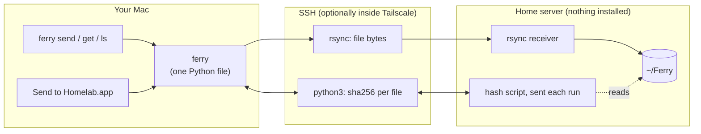
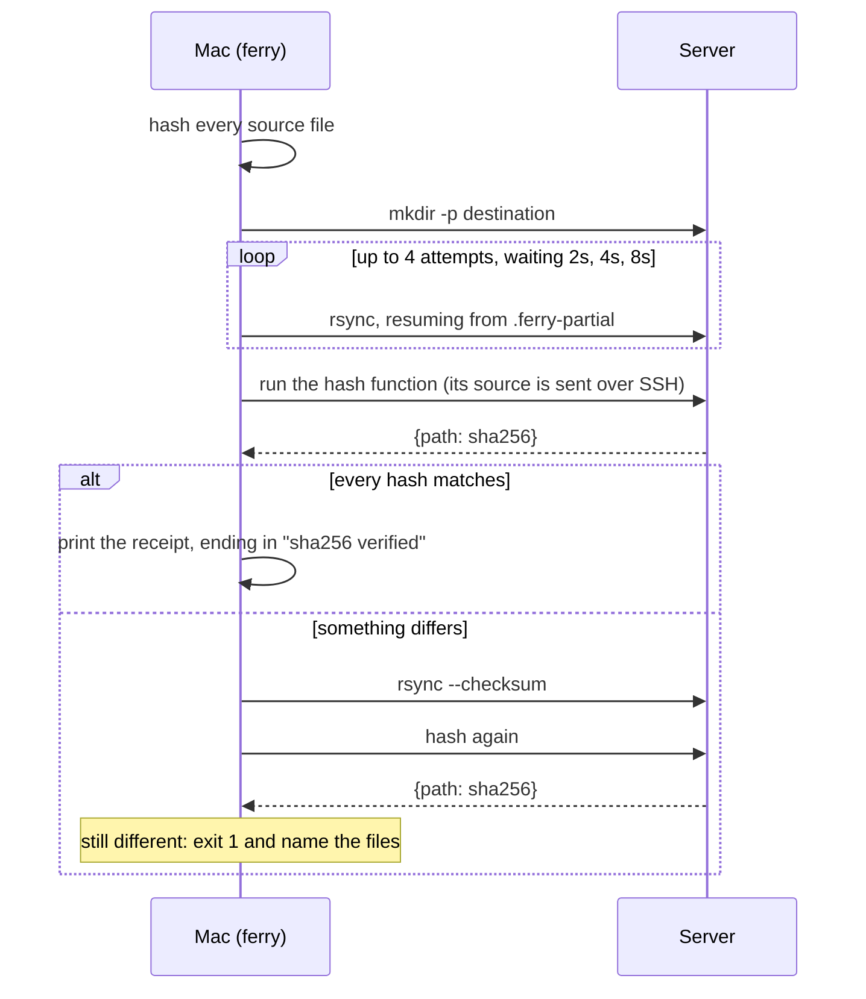

# ferry

Move files between your Mac and a home server with one command, and know they arrived intact.

```console
$ ferry send "Q3 photos" report.pdf
ferry: sent 3 file(s), 9.3 MB in 13.0s (0.7 MB/s), sha256 verified
  homelab:~/Ferry/Q3 photos
  homelab:~/Ferry/report.pdf
```

ferry is one Python file on top of tools you already have. [rsync](https://rsync.samba.org/) moves the bytes, [OpenSSH](https://www.openssh.com/) encrypts and authenticates them, and [Tailscale](https://tailscale.com/), if you use it, makes the server reachable from anywhere. ferry adds the parts those tools leave to you:

- a sha256 check of every file after it lands, with an automatic recopy if anything differs
- resume and retry when the connection drops
- partial files that never appear under their real name
- a plain receipt that a person or an agent can act on

## Install

You need macOS on the client. The server needs SSH login with a key, `rsync`, and `python3`; nothing else gets installed there. It has been tested with macOS on both ends.

```sh
git clone https://github.com/naman0r/ferry.git
cd ferry && ./install.sh
```

This links `ferry` into `~/.local/bin` and builds `Send to Homelab.app` into `~/Applications`.

ferry connects to the SSH alias `homelab`. Add one to `~/.ssh/config`:

```
Host homelab
    HostName my-server          # LAN name, IP, or Tailscale MagicDNS name
    User me
    IdentityFile ~/.ssh/id_ed25519
```

or point it anywhere with `FERRY_HOST=user@host`.

## Use

| Command | What it does |
| --- | --- |
| `ferry send <paths...> [-t DIR]` | Copy to the server. Default destination: `~/Ferry` |
| `ferry get <paths...> [-t DIR]` | Copy from the server. Default destination: the current directory |
| `ferry ls [DIR]` | List a server folder. Default: `~/Ferry` |

Relative remote paths resolve under `~/Ferry`, the drop folder. Use `~/...` or `/...` to reach anywhere else. A folder lands inside the destination, so `ferry send dir -t X` gives `X/dir`. Same-named files are overwritten and folders merge. ferry never deletes anything.

If you'd rather not use the terminal, drag files onto **Send to Homelab**, from the Dock or the Finder toolbar. You get a notification when they land, or an alert with the error if they don't.

## How it works



The steps of a send (`get` runs the same steps in the other direction):



Why it's built this way:

- **Nothing to install on the server.** The hash function is plain stdlib Python. ferry sends its source text over SSH and runs it with the server's `python3`, so the two sides can never run different versions.
- **Hashing closes a gap in rsync.** By default rsync skips any file whose size and modification time already match. If the destination holds a different file with the same size and date, rsync won't notice. ferry compares content and recopies with `--checksum`.
- **No half-written files.** An interrupted file waits in a hidden `.ferry-partial` folder, and the next attempt resumes from it. Anything watching `~/Ferry` only sees complete files.
- **Survives a laptop going idle.** Transfers run under [`caffeinate -i`](https://ss64.com/mac/caffeinate.html). Without it, an idle Mac drops into maintenance sleep and the link stalls.
- **One direction.** Only the Mac starts a transfer, so the Mac doesn't need an SSH server. Anything on the server can hand a file back by writing it into `~/Ferry` for a later `ferry get`.

The drag-and-drop app is a few lines of AppleScript, compiled with [`osacompile`](https://ss64.com/mac/osacompile.html), that calls `ferry send`.

## Agents

[`skill/SKILL.md`](skill/SKILL.md) is an [Agent Skill](https://agentskills.io/) that teaches a coding agent to use ferry and to recognise when a transfer is done. Copy the `skill` folder into your agent's skills directory as `ferry`, for example `~/.claude/skills/ferry` for [Claude Code](https://docs.anthropic.com/en/docs/agents-and-tools/agent-skills/overview).

## Tests

```sh
python3 test_ferry.py
```

These run offline and cover path resolution, hashing, and mismatch detection.

## Built on

- [rsync](https://rsync.samba.org/). macOS ships [openrsync](https://github.com/kristapsdz/openrsync), which ferry is tested against.
- [OpenSSH](https://www.openssh.com/)
- [Tailscale](https://tailscale.com/) (optional)
- macOS [`caffeinate`](https://ss64.com/mac/caffeinate.html) and [`osacompile`](https://ss64.com/mac/osacompile.html)

## License

[MIT](LICENSE)
